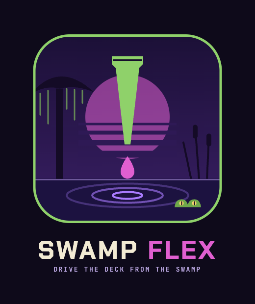

<p align="center">
  
</p>

# @vcjdeboer/opentrons-flex

Drive an [Opentrons Flex](https://opentrons.com/flex/) robot from
[swamp](https://swamp-club.com). Every method call is recorded in the swamp data
layer — health checks, instrument mounts, runs, commands — giving you a full
provenance trail of what the robot did and when.

No robot required — test against the
[bundled simulator](#testing-with-the-simulator) first.

## Install

```bash
swamp extension pull @vcjdeboer/opentrons-flex
```

## Setup

Create a model instance pointing at your robot (or simulator):

```bash
swamp model create @vcjdeboer/opentrons-flex my-flex \
  --global-arg host=198.51.100.1
```

Use the robot's IPv4 address, not a hostname — Deno's `fetch()` has no Happy
Eyeballs, so a hostname with a blackholed IPv6 route will hang.

## Run a transfer workflow

The extension ships a workflow that transfers liquid across four columns of a
96-well plate — one command:

```bash
swamp workflow run @vcjdeboer/opentrons-flex/flex-transfer
```

This opens a run, homes, loads the pipette and labware, picks up tips, aspirates
and dispenses four times (50 µL each, reusing tips), trashes the tips, homes,
and closes. Every step is recorded.

## Usage — step by step

```bash
# Is the robot reachable?
swamp model @vcjdeboer/opentrons-flex method run health my-flex

# What's mounted?
swamp model @vcjdeboer/opentrons-flex method run instruments my-flex

# Toggle the deck lights
swamp model @vcjdeboer/opentrons-flex method run lights my-flex --arg on=true

# Open a run session (needed for commands)
swamp model @vcjdeboer/opentrons-flex method run open_run my-flex

# Home the gantry
swamp model @vcjdeboer/opentrons-flex method run home my-flex \
  --arg runId=<run-id>

# Load pipette, labware, then transfer
swamp model @vcjdeboer/opentrons-flex method run load_pipette my-flex \
  --arg runId=<run-id> --arg pipetteName=p50_multi_flex --arg mount=right

swamp model @vcjdeboer/opentrons-flex method run load_labware my-flex \
  --arg runId=<run-id> \
  --arg labwareDefinitionUri=opentrons/opentrons_flex_96_tiprack_50ul/1 \
  --arg slot=B2

swamp model @vcjdeboer/opentrons-flex method run pick_up_tip my-flex \
  --arg runId=<run-id> --arg pipetteId=<id> --arg labwareId=<id>

swamp model @vcjdeboer/opentrons-flex method run aspirate my-flex \
  --arg runId=<run-id> --arg pipetteId=<id> --arg labwareId=<id> \
  --arg volume=50

swamp model @vcjdeboer/opentrons-flex method run dispense my-flex \
  --arg runId=<run-id> --arg pipetteId=<id> --arg labwareId=<id> \
  --arg volume=50

swamp model @vcjdeboer/opentrons-flex method run trash_tip my-flex \
  --arg runId=<run-id> --arg pipetteId=<id>

# Close the run when done
swamp model @vcjdeboer/opentrons-flex method run close_run my-flex \
  --arg runId=<run-id>
```

## Querying the trail

Every method writes to the swamp data layer. Query it:

```bash
# Latest health check
swamp data query 'model("my-flex") && specName == "health"' --select content

# All commands from a run
swamp data query 'model("my-flex") && specName == "command"' --select content

# Everything the robot did
swamp data list my-flex
```

## Testing with the simulator

You don't need a physical robot. This repo ships a minimal simulator that
responds to the same HTTP endpoints as the real Flex:

```bash
# Start the simulator (runs on port 31950 by default)
deno run --allow-net sim/fake_flex.ts

# Or on a custom port
deno run --allow-net sim/fake_flex.ts --port 8080
```

Then point a model at it:

```bash
swamp model create @vcjdeboer/opentrons-flex sim-flex \
  --global-arg host=localhost

swamp model @vcjdeboer/opentrons-flex method run health sim-flex
swamp model @vcjdeboer/opentrons-flex method run instruments sim-flex
swamp model @vcjdeboer/opentrons-flex method run lights sim-flex --arg on=true
```

The simulator handles health, instruments, lights, runs, and commands. Commands
succeed immediately — no motion, no physics — but the provenance trail in swamp
is identical to a real robot session.

## Methods

| Method | What it does | Writes |
|---|---|---|
| `health` | GET /health — is the robot reachable? | `health/health-current` |
| `instruments` | GET /instruments — what's mounted? | `instruments/mounted` |
| `lights` | GET or set deck lights | `lights/lights-current` |
| `open_run` | POST /runs — open a run session | `run_session/session` |
| `close_run` | Stop a run | `run_session/session` |
| `home` | Home the gantry (needs a run) | `command/home-<id>` |
| `load_pipette` | Load a pipette on a mount | `command/pipette` |
| `load_labware` | Load labware into a deck slot | `command/labware-<slot>` |
| `pick_up_tip` | Pick up tips from a tip rack | `command/pickUpTip-<id>` |
| `aspirate` | Aspirate liquid from a well | `command/aspirate-<id>` |
| `dispense` | Dispense liquid into a well | `command/dispense-<id>` |
| `drop_tip` | Return tips to a tip rack | `command/dropTip-<id>` |
| `trash_tip` | Eject tips into the trash bin | `command/trashTip-<id>` |

## License

MIT
